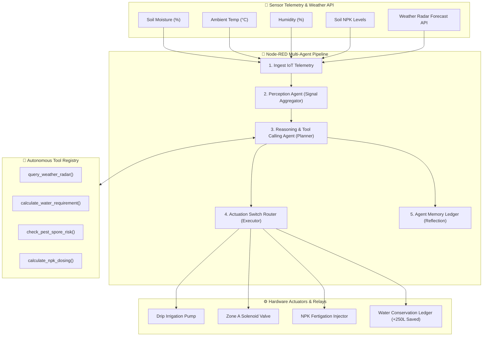

# 🌱 Agentic AI Framework for Smart Precision Agriculture

An autonomous, multi-agent IoT precision agriculture framework powered by **Node-RED**, **Node.js**, and **Express**. The system features a full **OODA (Observe, Orient, Decide, Act)** loop for autonomous decision-making, adaptive tool execution, rain forecast integration, pest biosecurity monitoring, and dynamic crop profile management.

---

## 🏛️ System Architecture



---

## 🌟 Key Features & Innovations

1. **Multi-Agent OODA Loop Architecture**:
   - **Perception**: Evaluates raw IoT sensor data into structured environmental signals (drought severity, fungal spore risks, rain proximity, NPK depletion).
   - **Reasoning**: Evaluates multi-factor goal conflicts (e.g. low soil moisture vs. incoming 92% rainstorm) and forms adaptive action plans.
   - **Tool Calling**: Autonomous invocation of specialized calculation tools (`query_weather_radar`, `calculate_water_requirement`, `check_pest_spore_risk`, `calculate_npk_dosing`).
   - **Actuation**: Drives field relays (drip irrigation pumps, solenoid valves, fertigation dosing injectors).
   - **Reflection**: Records thought traces and decision logs in long-term memory for auditing.

2. **Crop Profile Adaptive Thresholding**:
   - Supports 4 crop profiles: **Tomato** (Flowering), **Paddy Rice** (Submerged), **Wheat** (Tillering), and **Lettuce** (Vegetative).
   - Agent dynamically adjusts moisture targets and irrigation durations based on the active crop.

3. **Water Conservation & Rain Radar Conflict Resolution**:
   - When soil moisture is low but heavy rain is detected within 3 hours by weather radar, the agent **defers pump activation**, preventing root rot and saving ~250 Liters of water per cycle.

4. **Biosecurity & Pest Outbreak Monitoring**:
   - Detects combination of high humidity (>80%) and warm ambient temperatures (24°C - 33°C) that trigger *Late Blight (Phytophthora infestans)* spore germination risks.

5. **Integrated Node-RED Visual Flow Editor**:
   - Native Node-RED runtime running alongside Express at `/red`, with global context sharing between Express REST endpoints and Node-RED flows.

---

## 🚀 Quick Start Guide

### Prerequisites
- Node.js (v18 or higher)
- npm

### Installation & Execution
```bash
# Install dependencies
npm install

# Start the Smart Agriculture Framework server
node server.js
```

### Access Ports & Services
- 🖥️ **Web Dashboard**: `http://localhost:3000`
- 🔄 **Node-RED Flow Editor**: `http://localhost:3000/red`

---

## 📡 REST API Reference

| Endpoint | Method | Description |
|---|---|---|
| `/api/telemetry` | `GET` | Fetches real-time IoT field sensor data and actuator states |
| `/api/agent/memory` | `GET` | Retrieves agent decision logs and thought traces |
| `/api/agent/trigger` | `POST` | Forces an immediate autonomous OODA execution cycle |
| `/api/scenario` | `POST` | Injects field scenarios (`normal`, `drought`, `rain_approaching`, `pest_outbreak`, `npk_deficiency`) |
| `/api/crop` | `POST` | Switches active crop profile (`Tomato`, `Paddy Rice`, `Wheat`, `Lettuce`) |
| `/api/actuator` | `POST` | Manual operator override for relay actuators (`START_IRRIGATION`, `STOP_IRRIGATION`, etc.) |
| `/api/agent/memory` | `DELETE` | Clears agent decision history logs |

---

## 🧪 Environmental Stress Scenarios for Testing

- **🔄 Normal Baseline**: Optimal moisture (45%), low pest risk, balanced NPK.
- **🌵 Severe Drought**: Soil moisture drops to 22%, temperature spikes to 36.5°C (triggers pulsed drip irrigation).
- **🌧️ Rain Approaching**: Soil moisture drops to 26%, BUT heavy thunderstorm is 2 hours away (triggers rain delay action, deferring pump and saving water).
- **🐛 Pest Outbreak**: High humidity (91%) & ambient temp (31°C) triggers fungal spore biosecurity alert.
- **🧪 NPK Deficiency**: Nitrogen & Phosphorus critical depletion triggers fertigation liquid dosing pump.

---

## 📁 Project Structure

```
SmartAgri/
├── server.js              # Express server + Node-RED runtime engine integration
├── flows.json             # Node-RED 5-agent node flow configuration
├── package.json           # Node project dependencies (Express, Node-RED)
├── lib/
│   ├── simulator.js       # IoT field & weather telemetry simulator
│   └── agentic-engine.js  # Core Multi-Agent OODA decision & tool-calling engine
└── public/
    ├── index.html         # High-tech glassmorphic web dashboard UI
    ├── style.css          # CSS design system with visual progress meters & animations
    └── app.js             # Client dashboard logic, polling & interactive controls
```

---

## 🎓 University Major Project Presentation Notes

When presenting this project to reviewers/examiners:
1. Open `http://localhost:3000` on one side of your screen and `http://localhost:3000/red` on the other side.
2. Click **🌧️ Low Moisture + Incoming Rainstorm** scenario button to demonstrate **Conflict Resolution** (how the AI agent overrides standard moisture triggers to conserve water when rain is imminent).
3. Switch crop profiles to **Paddy Rice** or **Wheat** to show how target baselines and irrigation calculations automatically adapt.
4. Open the **Node-RED Editor** (`/red`) to show the 5-node visual flow handling real-time telemetry events.
